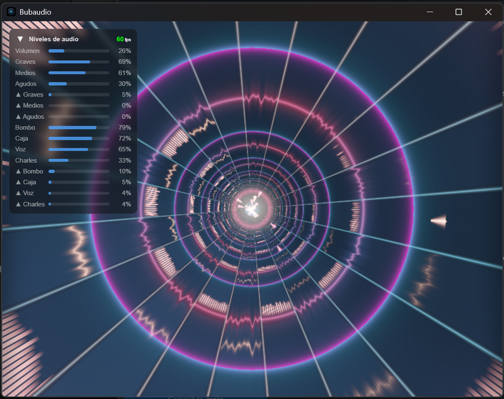
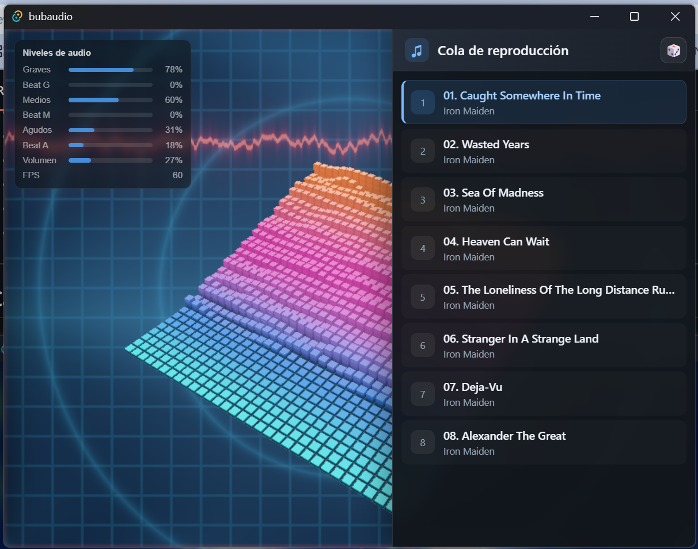
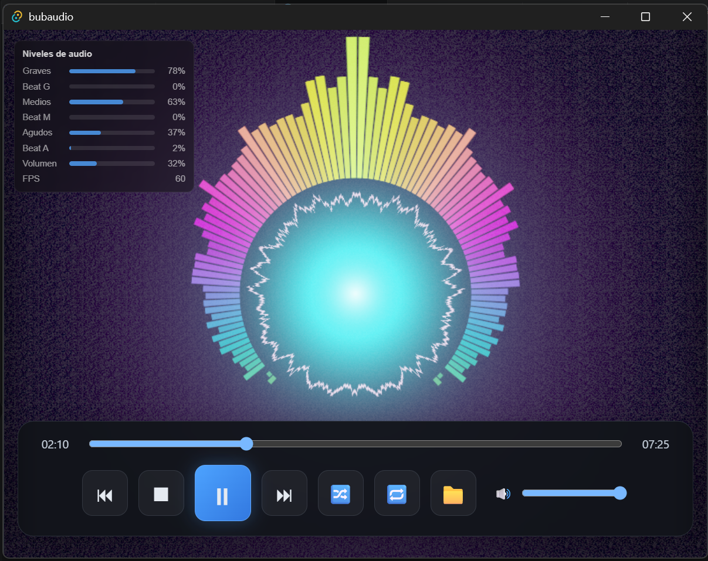
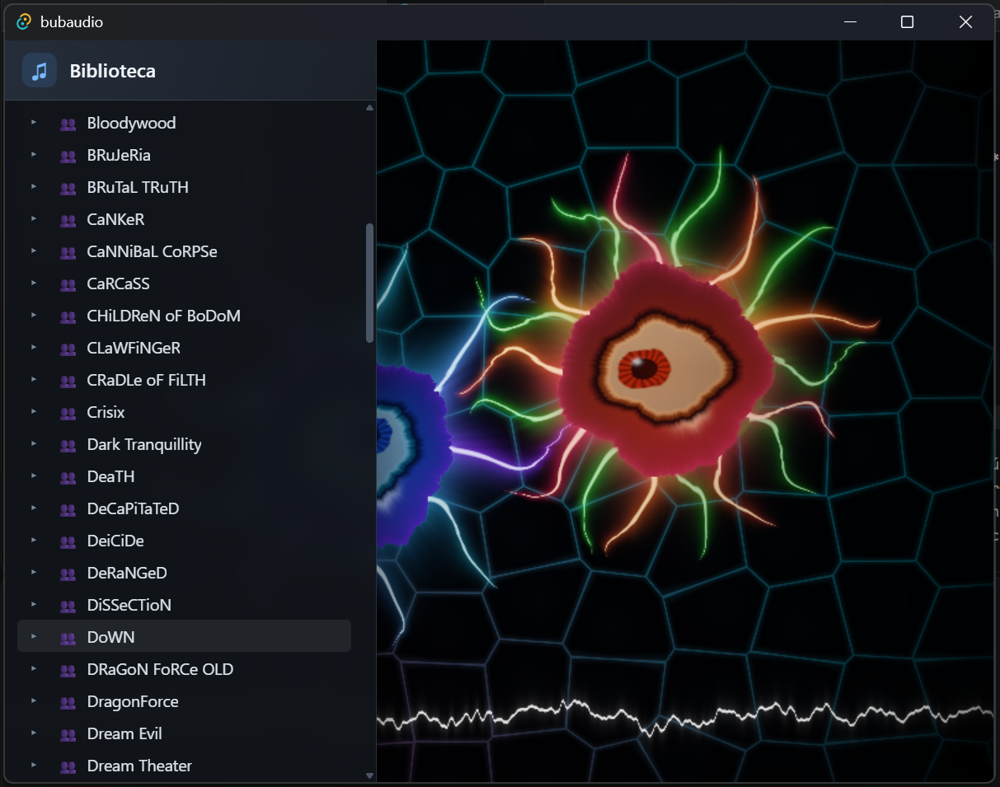

# Bubaudio

Bubaudio es un reproductor de música de escritorio creado con **Tauri**, **Vite**, **JavaScript** y **Three.js**.

El objetivo del proyecto es ofrecer una experiencia centrada en la colección musical local, con soporte para bibliotecas almacenadas en discos locales o unidades de red, junto con un visualizador de audio basado en shaders GLSL en tiempo real.

Actualmente el proyecto se encuentra en desarrollo activo.

Estoy utilizando herramientas de inteligencia artificial (IA) como apoyo para desarrollar este reproductor.

---

## Descarga

Puedes descargar el instalador de Bubaudio 0.5.2 en formato zip, el cual incluye un modulo de instalación <b>M</b>icro<b>S</b>oft <b>I</b>nstaller
- [Bubaudio 0.5.3 para Windows (x64)](https://github.com/devildrey33/Bubaudio/releases/download/RC/Bubaudio_0.5.3_x64_en-US.zip)



---

## Características

### Biblioteca musical

- Configuración de una o varias carpetas raíz, con selección de directorios al iniciar cuando aún no hay ninguna configurada.
- Panel de opciones para administrar las carpetas musicales y elegir la acción al iniciar.
- Temas oscuro y luminoso, seleccionables desde las opciones.
- Paneles de biblioteca y cola redimensionables arrastrando sus bordes; el ancho se guarda automáticamente.
- Consolidación automática de rutas anidadas: si una raíz contiene a otra, se conserva solo la raíz antecesora para evitar escaneos duplicados.
- Escaneo recursivo con panel central de progreso y recuento de artistas, álbumes y canciones encontrados.
- Indexación de artistas, álbumes y canciones, conservando la jerarquía de carpetas de la colección.
- Persistencia de la biblioteca en AppData.
- Soporte para bibliotecas almacenadas en NAS y recursos compartidos de red.

### Reproducción

- Cola de reproducción dinámica.
- Reordenación de canciones arrastrando una o varias canciones seleccionadas, también con shuffle activado.
- Guardado de listas personales desde la cola; aparecen en la carpeta «Listas guardadas» al principio de la biblioteca, se reproducen con doble clic y pueden añadirse a la cola o eliminarse desde el menú contextual.
- Historial de reproducción.
- Shuffle con orden mezclado persistente en la cola.
- Modos de repetición de canción, de cola y de repetición con shuffle.
- Generación de listas aleatorias de artistas, álbumes o 50 canciones, tanto desde el menú de la cola como al terminar la cola actual.
- Sugerencias de artistas y álbumes aleatorios; elegir una sugerencia reemplaza la cola y comienza la reproducción.
- Persistencia de shuffle y repetición en los ajustes.
- Restauración de la última cola, incluyendo su canción actual y el orden shuffle, con reproducción automática.
- Inicio opcional con un grupo aleatorio, un disco aleatorio o 50 canciones aleatorias.
- Navegación Next / Previous.
- El botón de canción anterior reinicia la canción actual si ya han pasado más de tres segundos.
- Control de volumen.
- Seek dentro de la canción.
- Opciones para cerrar Bubaudio y, con confirmación, programar el apagado de Windows.

### Interfaz

- Paneles de biblioteca, cola, controles y shaders con estilo oscuro coordinado.
- Árbol de biblioteca con iconos, carpetas plegadas por defecto y menús contextuales para añadir canciones a la cola.
- Menú de generación aleatoria en la cabecera de la cola.
- Selección múltiple de canciones con Ctrl y Shift; doble clic para reproducir y Suprimir para quitarlas de la cola.
- Indicadores visuales diferenciados para la selección y la canción que está sonando.
- Tooltip de canción a la izquierda y aviso independiente de listas aleatorias a la derecha.
- Doble clic en el fondo de la ventana para alternar pantalla completa.

### Visualizador

- Visualizador en tiempo real basado en Three.js.
- Datos FFT y Waveform procedentes de WebAudio.
- Cambio dinámico de shaders.
- Persistencia del shader seleccionado.
- Sistema extensible para nuevos visualizadores GLSL.

### Tecnologías

- Tauri
- Vite
- JavaScript ES2022+
- Three.js
- GLSL
- Web Audio API

---

## Estado actual

Implementado:

- [x] Ajustes persistentes
- [x] Configuración de varias carpetas raíz de música
- [x] Panel de opciones con configuración de inicio
- [x] Escaneo, progreso e indexación recursiva de la biblioteca
- [x] Guardado y carga de la biblioteca
- [x] PlaybackQueue
- [x] Sistema de historial
- [x] Shuffle y modos de repetición persistentes
- [x] Restauración y reproducción automática de la última cola
- [x] Generación inmediata y diferida de listas aleatorias
- [x] Reproducción local
- [x] Reproducción desde NAS
- [x] Paneles de biblioteca y cola
- [x] Visualizador GLSL
  - [x] Detectar agudos medios y graves
  - [x] Detectar bombo, caja, voz y charles
  - [x] Espectrograma
- [x] Selector de shaders

TODO FIRST (usar ia como si fuera un patito de goma que encima tiene la osiadia de contestar y dar su opinion) : 
// Buenos temas de charla para copilot del windows 11, y ya de paso preguntar por el fftSize.
- DILEMA!!! que accion deberia tener la rueda de ratón en general : { 
 - visualización REACTIVA (por ejemplo zoom camara o lo que le programe)
            o
 - SUBIR / BAJAR VOLUMEN absolutamente siempre...
}

- DILEMA2!! : Es posible calcular los BPM de la canción? Me resultaria util?

- DILEMA3!! : Seria muy complicado hacer listas con spotify y o algun otro servicio de streaming de audio?


En desarrollo (TODO) : 
SOLUCIONAR DILEMAS ANTES DE CONTINUAR
- [ ] Actualizaciones automáticas
- [ ] Busqueda en la librería
- [ ] Añadir url de internet a la queue (hay que vigilar porque actualmente abro las canciones del HD mediante un blob)
- [ ] Ecualizador
- [ ] Visualizador de escenas complejas Threejs (ahora mismo es un three.js con un plano2D simple)
- [ ]  - Utilizar nueva API de THREE.js (uff si yo me he enterado hace 2 dias... no auguro nada facil el cambio... pero es ULTRA necesario para TSL)
- [ ]  - TSL (SUPER IMPORTANTE PARA ESCENAS MAS DETALLADAS)
- [ ]  - Reactivo al mouse x, y, clicks, y talvez la rueda del raton
- [ ]  - Opciones de depuración para cada shader (he pensado en un lector de fragments que sustituya las macros por uniforms si está en modo debug)
- [ ]  - Decidir fftSize, o añadir una opcion para modificar el fftSize 
- [ ] Eventos mouse y teclado
- [ ]  - supongo que lo mejor seria abstenerse en la queue y la library
- [ ]  - controlar volumen con la rueda del raton, tambien con + y -, y mostrar el nivel de volumen discretamente en la visualización
- [ ]  - Espacio = play / pausa, definir teclas de cancion adelante / atras.
- [ ]  - tecla para lista aleatoria
- [ ]  - Opciones -> teclado
- [ ] Añadir opcion para saltar al siguiente shader en X segundos, y checkbox en el panel de shaders.
- [ ] Añadir favoritos a la cola en el menu del botón nueva cola aleatória
- [ ] Drag & Drop desde el explorador al reproductor a una nueva cola (problemon si no esta añadida la ruta en la librería, en RAVE acabe añadiendo la ruta a la lista de rutas de las librerias de audio (y descartandola en caso de tener una ruta superior), pero... ya veremos si vale la pena.... yo ya me entiendo xd)
- [ ] Historial de modificaciones en la queue (control + z / y)
- [ ] Metadatos ID3
- [ ] Carátulas
- [ ] Shader de hipnosapo con publicidad subliminal 3d que me ayudara a dominar el mundo. JAQUE MATE CABRONES


---

## Arquitectura

```text
Application
│
├── PlayerSettings
│
├── LibraryIndexer
│
├── Player
│   │
│   ├── PlaybackQueue
│   │
│   └── AudioAnalyzer
│
├── PlayerControls
│
└── Visualizer
```

---

## Formatos soportados

Actualmente Bubaudio detecta:

- MP3
- FLAC
- OGG
- OPUS
- WAV
- M4A
- AAC

---

## Capturas






---

## Objetivo del proyecto

Bubaudio nace como un reproductor orientado a usuarios que mantienen grandes colecciones de música local y desean una experiencia rápida, ligera y altamente visual, sin depender de servicios de streaming.

---

## NOTAS para el desarrollador
### Para actualizar la versión del reproductor

Usa el script para sincronizar la versión de npm, Tauri y Cargo en un solo paso:

```powershell
npm.cmd run set-version -- 0.5.1
```

Sustituye `0.5.1` por la nueva versión semántica. El comando actualiza los manifiestos y los archivos de bloqueo.

---

## Licencia

Este proyecto está distribuido bajo los términos de la Mozilla Public License 2.0 (MPL-2.0).

Consulta el archivo LICENSE para más información.
