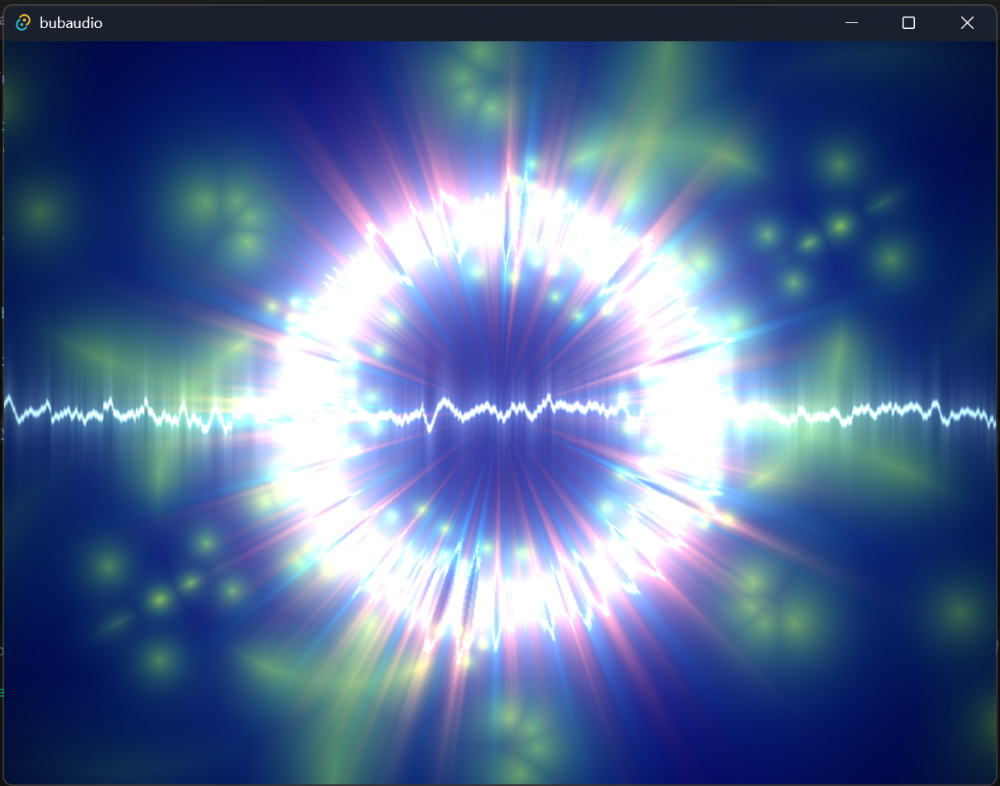

# BubAudio

BubAudio es un reproductor de música de escritorio creado con **Tauri**, **Vite**, **JavaScript** y **Three.js**.

El objetivo del proyecto es ofrecer una experiencia centrada en la colección musical local, con soporte para bibliotecas almacenadas en discos locales o unidades de red, junto con un visualizador de audio basado en shaders GLSL en tiempo real.

Actualmente el proyecto se encuentra en desarrollo activo.

---

## Características

### Biblioteca musical

- Configuración de una o varias carpetas raíz, con selección de directorios al iniciar cuando aún no hay ninguna configurada.
- Consolidación automática de rutas anidadas: si una raíz contiene a otra, se conserva solo la raíz antecesora para evitar escaneos duplicados.
- Escaneo recursivo con panel central de progreso y recuento de artistas, álbumes y canciones encontrados.
- Indexación de artistas, álbumes y canciones, conservando la jerarquía de carpetas de la colección.
- Persistencia de la biblioteca en AppData.
- Soporte para bibliotecas almacenadas en NAS y recursos compartidos de red.

### Reproducción

- Cola de reproducción dinámica.
- Historial de reproducción.
- Shuffle con orden mezclado persistente en la cola.
- Modos de repetición de canción, de cola y de repetición con shuffle.
- Generación de listas aleatorias de artistas, álbumes o 50 canciones, tanto desde el menú de la cola como al terminar la cola actual.
- Sugerencias de artistas y álbumes aleatorios; elegir una sugerencia reemplaza la cola y comienza la reproducción.
- Persistencia de shuffle y repetición en los ajustes.
- Navegación Next / Previous.
- El botón de canción anterior reinicia la canción actual si ya han pasado más de tres segundos.
- Control de volumen.
- Seek dentro de la canción.
- Opciones para cerrar BubAudio y, con confirmación, programar el apagado de Windows.

### Interfaz

- Paneles de biblioteca, cola, controles y shaders con estilo oscuro coordinado.
- Árbol de biblioteca con iconos, carpetas plegadas por defecto y menús contextuales para añadir canciones a la cola.
- Menú de generación aleatoria en la cabecera de la cola.
- Tooltip de canción a la izquierda y aviso independiente de listas aleatorias a la derecha.
- Doble clic en el fondo de la ventana para alternar pantalla completa.

### Visualizador

- Visualizador en tiempo real basado en Three.js.
- Datos FFT y Waveform procedentes de WebAudio.
- Cambio dinámico de shaders.
- Persistencia del shader seleccionado.
- Sistema extensible para nuevos visualizadores GLSL.

### Tecnologías

- Tauri
- Vite
- JavaScript ES2022+
- Three.js
- GLSL
- Web Audio API

---

## Estado actual

Implementado:

- [x] Ajustes persistentes
- [x] Configuración de varias carpetas raíz de música
- [x] Escaneo, progreso e indexación recursiva de la biblioteca
- [x] Guardado y carga de la biblioteca
- [x] PlaybackQueue
- [x] Sistema de historial
- [x] Shuffle y modos de repetición persistentes
- [x] Generación inmediata y diferida de listas aleatorias
- [x] Reproducción local
- [x] Reproducción desde NAS
- [x] Paneles de biblioteca y cola
- [x] Visualizador GLSL
- [x] Selector de shaders

En desarrollo:

- [ ] Metadatos ID3
- [ ] Carátulas
- [ ] Listas de reproducción
- [ ] Búsqueda de canciones
- [ ] Filtros por artista, álbum y género
- [ ] Ecualizador
- [ ] ReplayGain

---

## Arquitectura

```text
Application
│
├── PlayerSettings
│
├── LibraryIndexer
│
├── Player
│   │
│   ├── PlaybackQueue
│   │
│   └── AudioAnalyzer
│
├── PlayerControls
│
└── Visualizer
```

---

## Formatos soportados

Actualmente BubAudio detecta:

- MP3
- FLAC
- OGG
- OPUS
- WAV
- M4A
- AAC

---

## Capturas



---

## Objetivo del proyecto

BubAudio nace como un reproductor orientado a usuarios que mantienen grandes colecciones de música local y desean una experiencia rápida, ligera y altamente visual, sin depender de servicios de streaming.

---

## Licencia

Este proyecto está distribuido bajo los términos de la Mozilla Public License 2.0 (MPL-2.0).

Consulta el archivo LICENSE para más información.
