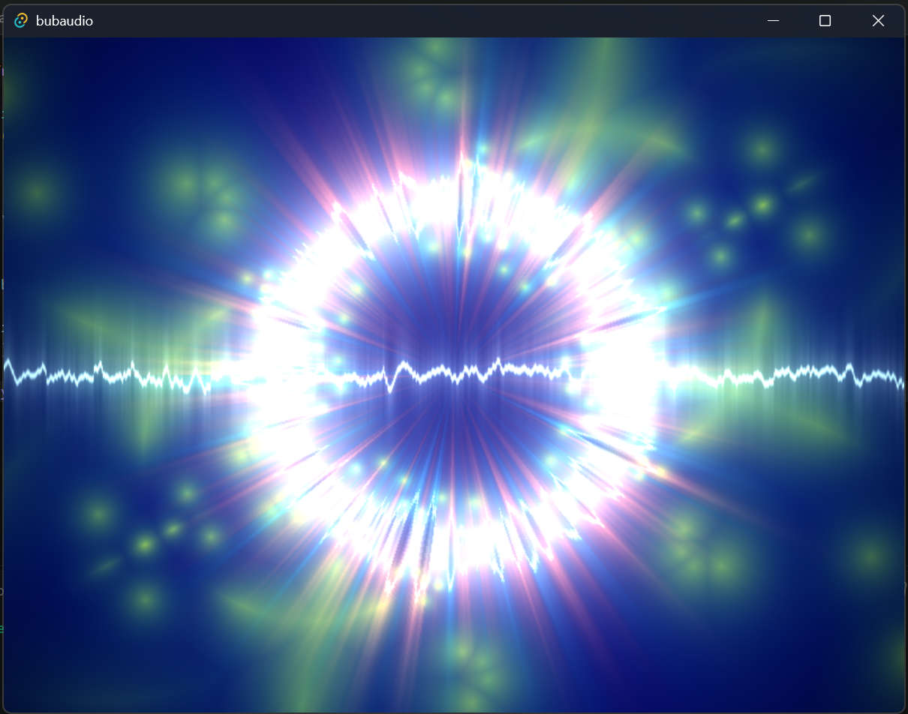

# BubAudio

BubAudio es un reproductor de música de escritorio creado con **Tauri**, **Vite**, **JavaScript** y **Three.js**.

El objetivo del proyecto es ofrecer una experiencia centrada en la colección musical local, con soporte para bibliotecas almacenadas en discos locales o unidades de red, junto con un visualizador de audio basado en shaders GLSL en tiempo real.

Actualmente el proyecto se encuentra en desarrollo activo.

---

## Características

### Biblioteca musical

- Escaneo recursivo de carpetas musicales.
- Indexación de artistas, álbumes y canciones.
- Persistencia de la biblioteca en AppData.
- Soporte para bibliotecas almacenadas en NAS y recursos compartidos de red.

### Reproducción

- Cola de reproducción dinámica.
- Historial de reproducción.
- Shuffle.
- Repeat Track.
- Repeat Queue.
- Navegación Next / Previous.
- Control de volumen.
- Seek dentro de la canción.

### Visualizador

- Visualizador en tiempo real basado en Three.js.
- Datos FFT y Waveform procedentes de WebAudio.
- Cambio dinámico de shaders.
- Persistencia del shader seleccionado.
- Sistema extensible para nuevos visualizadores GLSL.

### Tecnologías

- Tauri
- Vite
- JavaScript ES2022+
- Three.js
- GLSL
- Web Audio API

---

## Estado actual

Implementado:

- [x] Ajustes persistentes
- [x] Selector de carpeta musical
- [x] Escaneo e indexación de biblioteca
- [x] Guardado y carga de la biblioteca
- [x] PlaybackQueue
- [x] Sistema de historial
- [x] Reproducción local
- [x] Reproducción desde NAS
- [x] Visualizador GLSL
- [x] Selector de shaders

En desarrollo:

- [ ] Metadatos ID3
- [ ] Carátulas
- [ ] Biblioteca visual
- [ ] Listas de reproducción
- [ ] Búsqueda de canciones
- [ ] Filtros por artista, álbum y género
- [ ] Ecualizador
- [ ] ReplayGain

---

## Arquitectura

```text
Application
│
├── PlayerSettings
│
├── LibraryIndexer
│
├── Player
│   │
│   ├── PlaybackQueue
│   │
│   └── AudioAnalyzer
│
├── PlayerControls
│
└── Visualizer
```

---

## Formatos soportados

Actualmente BubAudio detecta:

- MP3
- FLAC
- OGG
- OPUS
- WAV
- M4A
- AAC

---

## Capturas



---

## Objetivo del proyecto

BubAudio nace como un reproductor orientado a usuarios que mantienen grandes colecciones de música local y desean una experiencia rápida, ligera y altamente visual, sin depender de servicios de streaming.

---

## Licencia

Este proyecto está distribuido bajo los términos de la Mozilla Public License 2.0 (MPL-2.0).

Consulta el archivo LICENSE para más información.
